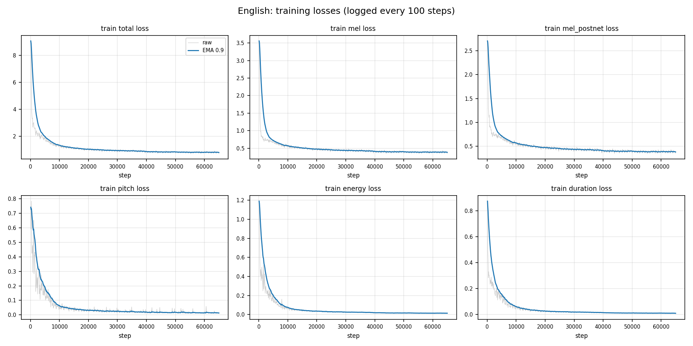
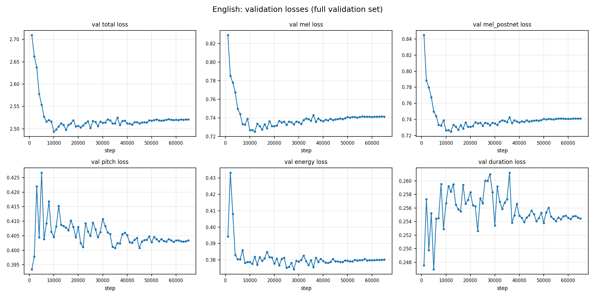
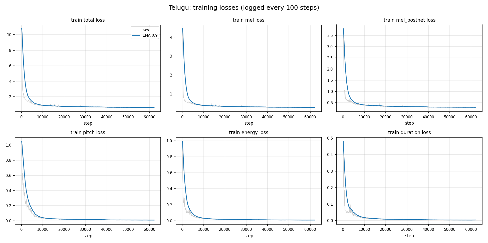
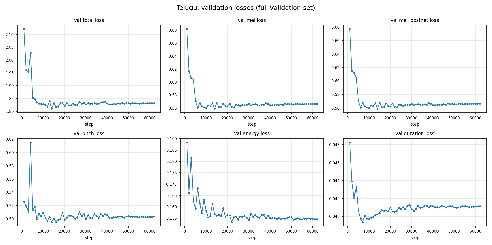
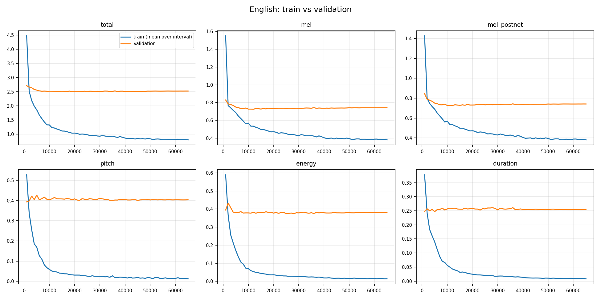
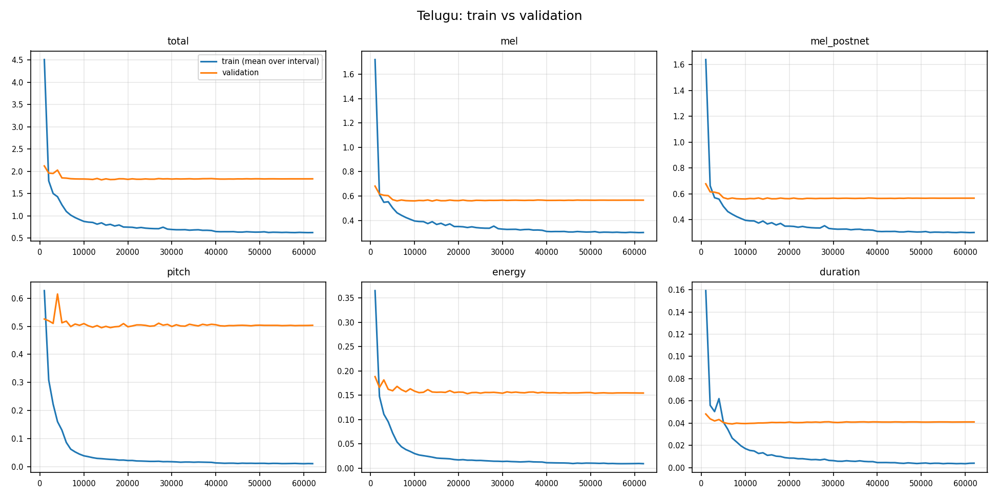

# FastSpeech 2 for English and Telugu: Technical Report

Snehitha Andapally · Research Assistant assignment, Speech Processing Lab, LTRC, IIIT Hyderabad · November 2026

Code: https://github.com/snehithareddy28/fastspeech2-assignment. Every number in this report
is read from the files in `Results/` produced by the training and inference runs; none is
estimated. Listening observations are the author's (a native Telugu speaker).

## 1. Summary

Two FastSpeech 2 models were trained from scratch, one on ~5 h of Indian-accented English
(Svarah) and one on ~5 h of single-speaker Telugu (IndicTTS Telugu), starting from the
ming024 PyTorch implementation. The architecture is unchanged. The work is in the data
pipeline (selection, alignment, Telugu G2P, normalisation), compatibility fixes, and
training/inference tooling. Both models produce intelligible speech for all ten test
sentences. Telugu sounds clean and natural, including numbers and phrase-final lengthening;
English is intelligible but audibly noisy. The most notable failures come from text
processing, not from the acoustic model: "rhyth m" is read as "rye-th em", "andaroo" gets
English timing, and the Telugu loanword in T1 keeps the long vowels of its spelling. The
English model also does not realise the lexical stress contrast in E2a/E2b, although the
frontend supplies it. Validation loss stops improving after about 10k steps in both
languages while training loss keeps falling, which shows overfitting to ~5 h of data.

## 2. Implementation

### 2.1 Components used from ming024

Unchanged: Transformer encoder (4 FFT blocks) and decoder (6 FFT blocks), hidden size 256,
2 heads, conv1d FFN (kernel 9, filter 1024); variance adaptor with duration, pitch and
energy predictors (2 conv layers, kernel 3, dropout 0.5); phoneme-level pitch and energy,
quantised into 256 linear bins with learned embeddings; length regulator; PostNet; losses
(L1 on mel before and after PostNet, MSE on log-duration, pitch, energy); Noam warm-up LR
schedule with step annealing; pretrained HiFi-GAN "universal" vocoder. About 35 M parameters
(35,081,025 for Telugu and 35,118,401 for English, which has the larger symbol table and
a speaker embedding table; counted by the training script).

### 2.2 Changes common to both languages

Full list with reasons: `docs/CHANGES.md`; the first commit is the pristine upstream code,
so every change is a reviewable diff.

* **Compatibility.** librosa >= 0.10 keyword-only APIs; a hard-coded `.cuda()` in the STFT
  removed (preprocessing needed a GPU); `torch.load(weights_only=False)` for torch >= 2.6.
* **Bug fixes.** The energy predictor received `p_control` instead of `e_control`. MFA >= 2
  writes silences as empty intervals; upstream read TextGrids without them, which loses
  silence frames from the duration sum. Unknown phones were silently dropped, which would
  desynchronise phones and durations; they now raise.
* **Per-language symbol tables.** Upstream used one table (ARPAbet + pinyin) for all data.
  Each model now has its own table and embedding size.
* **Fixed, documented split.** The split is decided at data-selection time and grouped by
  transcript, so the same sentence never appears in both train and validation (upstream
  took a random `val_size` cut). Pitch/energy normalisation statistics come from the
  training split only.
* **Training infrastructure.** Resumable checkpoints (model, optimizer, step, RNG) every
  1000 steps, best-by-validation checkpoint, CSV loss logs, wall-clock budget, single-GPU
  device selection.
* **Inference.** A sentence file is read verbatim; the frontend normalises and converts to
  phones; the script saves audio, duration/pitch/energy plots and a JSON of every predicted
  value with the G2P source of each word.

### 2.3 English-specific

* **G2P.** Upstream looked each word up in a lexicon and took the first pronunciation, so
  heteronyms could never be distinguished. Here g2p_en runs on the whole normalised
  sentence: its POS tagger selects between homograph pronunciations, CMUdict covers known
  words, and its neural model handles out-of-vocabulary words.
* **Alignment lexicon.** All LibriSpeech/CMU variants for in-vocabulary words plus g2p_en
  pronunciations for OOV words, so MFA chooses the variant that matches the audio and no
  training word is unknown.
* **Normalisation** (`fastspeech2/text/english.py`): `H:MM` -> hour + minutes (":00" ->
  "o'clock", "05" -> "oh five"); AM/PM -> letter names; `<day> <Month> <year>` ->
  ordinal day, month, year read in pairs ("12 November 2026" -> "twelfth November twenty
  twenty six"); other 4-digit numbers 1000 to 2099 as years; remaining digits as cardinals.
* **Multi-speaker.** Svarah has many speakers with a few minutes each, so a speaker
  embedding table is used (upstream `multi_speaker: True`). Test sentences use the speaker
  with the most training data.

### 2.4 Telugu-specific

* **Phone set.** 50 ASCII phones (vowels with length, aspirated and retroflex consonants,
  homorganic nasals) plus `sp`/`spn`/`sil`. Retroflexes carry an `x` suffix (`tx`, `dx`,
  `nx`, `lx`, `sx`).
* **Rule-based G2P** (`fastspeech2/text/telugu.py`). Telugu script is close to phonemic, so
  rules suffice: every consonant carries the inherent /a/ unless followed by a vowel sign or
  virama; conjuncts follow from the virama rule (పట్టు -> `p a tx tx u`); anusvara becomes
  the nasal homorganic with the next consonant (బలంగా -> `b a l a ng g aa`, ఉంది ->
  `u n d i`) and /m/ word-finally (సమావేశం -> `... sh a m`); visarga -> /h/. Not modelled:
  word-initial e -> ye glide, sandhi across words, loanword pronunciation. The
  normaliser output and the phone strings for all Telugu test sentences were checked by a
  native Telugu speaker (the author) and judged correct.
* **Number normalisation.** Telugu digits are mapped to ASCII; cardinals use Indian grouping
  with combining forms (2026 -> రెండు వేల ఇరవై ఆరు); `<n>వ` becomes an ordinal (12వ ->
  పన్నెండవ); `HH:MM` is read as two cardinals (10:45 -> పది నలభై ఐదు).
* **Alignment.** No pretrained Telugu MFA model exists. Two options were considered:
  (a) train an MFA (GMM-HMM, speaker-adapted) acoustic model on the selected subset with the
  rule-based lexicon, or (b) character input with a learned/CTC aligner. (a) was chosen:
  it keeps the upstream duration pipeline unchanged, and a phonemic script with one speaker
  and ~6 h is enough for a GMM-HMM to align well. (b) would need architectural changes
  (an alignment module and its loss) with no time to tune them. Fallback if MFA training
  failed: CTC forced alignment with a multilingual wav2vec2 model (torchaudio MMS) over
  romanised characters, implemented in `scripts/ctc_align.py` (MMS-300m forced-alignment
  model, own Viterbi pass, same TextGrid output). On 4 real IndicTTS utterances it aligned
  4/4, with intervals it labelled as silence averaging -42 dB relative to peak versus -13 dB
  for phone intervals. It was not needed: the final Telugu alignments come from the trained
  MFA model (MFA 3.4.3), which aligned 1501 of 1528 selected utterances; the 27 failures
  were dropped. MFA splits work by speaker, so a single-speaker corpus silently ran on one
  CPU core (about 3.5 h for acoustic model training) until `--single_speaker` was passed.
* **Chunking long utterances.** IndicTTS Telugu utterances are long (in a 500-utterance
  sample: median 18.9 s, 95th percentile 46.4 s; only 7 % of audio is in utterances of
  11 s or less). Utterances up to 30 s are selected and aligned whole, then split at MFA
  pauses of at least 0.15 s into training items of at most 10 s (the decoder's positional
  table covers 1000 frames = 11.6 s). Chunks inherit their source utterance's split.

## 3. Data

| | English (Svarah) | Telugu (IndicTTS Telugu) |
|---|---|---|
| Source | `ai4bharat/Svarah`, split `test` (the only split; 6656 utterances, 9.61 h) | `SPRINGLab/IndicTTS_Telugu`, split `train` (8576 utterances, 36.71 h) |
| Native sample rate | 16 kHz (all selected files) | 16 kHz (all selected files) |
| Speakers used | 49 of 115 recovered (67 had >= 3 min) | 1 (female; 13.3 h usable vs 11.4 h male) |
| Speaker identity | metadata tuple (no speaker-id column; file names carry no ID) | `gender` label (two speakers) |
| Duration filter | 1 to 30 s, then chunked to <= 10 s | 1 to 30 s, then chunked to <= 10 s |
| Text filter | plain English characters, >= 2 words | pure Telugu script after normalisation, G2P covers every character, >= 2 words |
| Selected (before trimming) | train 5.47 h (3087 utts) / val 1.17 h (637 utts) | train 5.50 h (1273 utts) / val 1.10 h (255 utts) |
| After alignment + trimming | train 5.01 h (3510 items) / val 1.07 h (729 items) | train 4.81 h (2408 items) / val 0.96 h (475 items) |
| Alignment coverage | 3724 / 3724 (pretrained `english_us_arpa`) | 1501 / 1528 (MFA trained on the subset) |
| Lexicon | 6521 words, 1118 OOV via g2p_en (many are Indian names, places and words) | 13011 words, all by rule |

**Selection strategy.** English: Svarah has no speaker-id column and its file names carry no
speaker ID, so speakers are recovered from the tuple of speaker metadata columns (gender, age group, first language, state, district,
qualification, job, occupation). The recovered identity is an approximation and is
recorded in the summary. Speakers with at least 3 minutes of usable audio are ranked by
amount of audio and taken in order until ~6.6 h is reached; fewer speakers with more audio
each give better-trained speaker embeddings than many speakers with a minute each.
Telugu: a single speaker for stability (`speaker: auto` picks the one with more usable
audio), random sampling with a fixed seed. In both cases the validation share (1/6) is
taken within each speaker and grouped by normalised transcript; the script asserts that no
transcript appears in both splits. The selection target is 10 % above 5 h + 1 h because
leading/trailing silence trimming and chunking remove audio; the final hours are in the
table. Lists of selected utterances: `Results/<Lang>/data_selection.tsv`.

**Preprocessing.** Mono, resampled to 22.05 kHz (both sources are upsampled, so the mel
bands above 8 kHz are empty; the HiFi-GAN mel range is 0 to 8 kHz anyway), peak-normalised.
80-band log-mel, 1024-point FFT, hop 256. F0 with WORLD DIO + StoneMask (65 to 500 Hz),
unvoiced frames linearly interpolated, averaged per phone. Energy = L2 norm of the STFT
magnitude frame, averaged per phone. Both z-normalised with training-set statistics.

## 4. Training configuration

| | English | Telugu |
|---|---|---|
| Steps | 65,000 (planned total reached) | 62,211 of 65,000 (stopped by the 5.1 h budget) |
| Batch size | 16 | 16 |
| Optimiser | Adam (0.9, 0.98), eps 1e-9, Noam warm-up 4000, x0.3 at 60/80/90 % of steps | same |
| Gradient clip | 1.0 | 1.0 |
| Precision | fp16 mixed precision (AMP) | same |
| GPU, wall-clock | 1 x Tesla T4 (Kaggle), 4.72 h | 1 x Tesla T4 (Kaggle), 5.10 h |
| Throughput | 4.06 it/s (median) | 3.52 it/s (median) |
| Checkpoint used for results | best validation total loss, step 10,000 | best validation total loss, step 14,000 |

The two languages were trained one after the other in one 10.5 h Kaggle session. Running
them in parallel on the two T4s was tried first and was CPU-bound on the 4-core machine
(about 1.1 it/s each, against about 3.8 it/s for one run alone), so sequential training
gave more steps per language. fp16 AMP was measured at 3.8 it/s against 1.7 it/s in fp32 on
the same GPU, with matching validation loss in a short smoke test. Two bugs only appeared on GPU
and were fixed: energy targets reached the loss as float64 (the CUDA backward pass
rejects mixed dtypes), and torch 2.11 rejects `set_device("cuda")` without an index. The
final-step checkpoints were also synthesised; they sounded the same as the best ones.

## 5. Loss curves









| Loss | EN train (last 1k steps) | EN val best (step) | EN val final | TE train (last 1k steps) | TE val best (step) | TE val final |
|---|---|---|---|---|---|---|
| total | 0.798 | 2.494 (10k) | 2.521 | 0.622 | 1.810 (14k) | 1.832 |
| mel | 0.382 | 0.725 (12k) | 0.741 | 0.299 | 0.559 (14k) | 0.567 |
| pitch | 0.013 | 0.393 (1k) | 0.403 | 0.011 | 0.495 (14k) | 0.504 |
| energy | 0.015 | 0.374 (28k) | 0.380 | 0.009 | 0.153 (22k) | 0.155 |
| duration | 0.008 | 0.247 (5k) | 0.254 | 0.004 | 0.039 (7k) | 0.041 |

* **Convergence.** Validation mel loss flattens by about 8k to 10k steps in both languages
  and changes by less than 3 % afterwards. Training loss keeps falling until the end.
* **Overfitting.** Clear in the variance predictors: training pitch, energy and duration
  losses fall to about 0.01, while validation stays at 0.04 to 0.50, roughly 10 to 45 times
  higher, and is flat or slightly rising after its minimum. Validation mel loss rises
  slowly (English 0.725 at 12k to 0.741 at 65k; Telugu 0.559 to 0.567). The best
  checkpoints are therefore early ones; with ~5 h of data, more steps do not help
  generalisation.
* **Stability.** No spikes in training loss and no non-finite-loss skips in either run
  (`train_stdout.log`). The Telugu validation pitch loss has one spike at 4k (0.62) during
  warm-up. The first LR anneal at 39k gives a small step down in training loss (English
  0.899 to 0.852, Telugu 0.673 to 0.647, mean over the 2k steps before and after) and no
  change in validation loss.
* **English vs Telugu.** English validation losses are higher for mel (0.73 vs 0.56),
  energy (0.37 vs 0.15) and especially duration (0.25 vs 0.04). This fits 49 speakers with
  varied recording conditions and speaking styles, where duration and energy are much less
  predictable from phones alone, against one studio speaker reading in a consistent style.
  Telugu pitch loss is higher (0.50 vs 0.39), plausibly because the female voice has a wider
  F0 range in absolute terms (the test outputs span 147 to 332 Hz vs 109 to 182 Hz).

## 6. Test sentences: generated speech

Audio: `Results/<Lang>/test_generated_audios/<ID>.wav`. The normalised text and phone
sequence below are produced by the frontend (copied from the per-utterance JSON).
Listening observations are the author's, made on the generated files.

### English

| ID | Frontend output (deterministic, verified) | Listening observations |
|---|---|---|
| E1 | "antidisestablishmentarianism" is in CMUdict: `AE2 N T AY0 D IH0 S AH0 S T AE2 B L IH0 SH M AH0 N T EH1 R IY0 AH0 N IH0 Z AH0 M` (28 phones) | The long word is clear and intact. As in all English outputs, the audio has audible background noise (see Section 8). |
| E2a | "conduct" tagged NN -> `K AA1 N D AH0 K T` (noun stress) | Sounds natural, but no stress is audible on either syllable (see E2b). Predicted: AA1 58 ms / 140 Hz, AH0 104 ms / 130 Hz; the stressed vowel is shorter than the unstressed one and the pitch step is only 10 Hz. |
| E2b | "conduct" tagged VB -> `K AA0 N D AH1 K T` (verb stress) | Sounds natural, but no stress contrast with E2a is audible. Predicted: AA0 58 ms / 130 Hz, AH1 35 ms / 133 Hz, i.e. the stressed vowel is again the shorter one and pitch is flat. The frontend does choose the correct stress (the phone symbols differ: AA1/AH0 vs AA0/AH1), but the model has not learned to realise lexical stress as duration or pitch. Plausible reasons: Indian English, the variety in Svarah, marks lexical stress weakly and less consistently than US English, the CMUdict stress labels are US English, and 5 h of data gives few contrasting examples. |
| E3 | "rhyth" is OOV -> neural G2P `R AY1 DH`; "m" -> letter name `EH1 M`. Neither the space nor the G2P recover "rhythm" (`R IH1 DH AH0 M`) | Heard as "rye-th em", as predicted by the phones: the model faithfully speaks what the frontend gives it; the error is entirely in text processing, not in the acoustic model. |
| E4 | normalised to "ten forty five {A M} on twelfth November twenty twenty six, so andaroo ..."; AM as letter names `EY1 EH1 M`; "andaroo" OOV -> `AE0 N D AA1 R OW0` | Time and date sound perfect. "andaroo" sounds rushed: its predicted vowels (AE0 70, AA1 58, OW0 70 ms) are no longer than the sentence's average vowel (63 ms), whereas Telugu అందరూ ends in a long /uu/ (the Telugu model predicts about 100 to 120 ms for long vowels). The English G2P reads it with English vowels (AE, OW) and English stress, so a Telugu word in an English sentence gets English timing. |

### Telugu

| ID | Frontend output (deterministic, verified) | Listening observations |
|---|---|---|
| T1 | న్యూరోఫార్మకోలాజికల్ -> `n y uu r oo ph aa r m a k oo l aa j i k a l` (19 phones, a loanword; ఫ is read as aspirated /ph/, while Telugu speakers often say /f/) | The "-colo-" part is heard as "koolaa". Predicted durations confirm both vowels are long (oo 116 ms, aa 104 ms), as written in కోలా: the English reduced/short vowels (/kəˈlɒ/) are lost because the rule-based G2P reads the script literally and has no loanword handling. ఫ is realised as /ph/, not /f/. |
| T2a | పట్టు -> `p a tx tx u` (grip) | See T2b. |
| T2b | పట్టు -> `p a tx tx u` (silk): identical phones to T2a, so any difference can only come from context through the encoder | T2a and T2b sound the same. Predictions for పట్టు differ only slightly (total 325 vs 313 ms; mean F0 206 vs 212 Hz), consistent with its different position in the sentence (phone 11 of 31 vs 3 of 37) rather than with meaning. The encoder does see the neighbouring phones (e.g. `c ii r a` of చీరను in T2b), but word boundaries are dropped before the model and nothing in training links a sense to a pronunciation. Here that is the correct behaviour: a native speaker confirms the two senses of పట్టు are pronounced the same, so this homograph needs no disambiguation (unlike English E2a/E2b). |
| T3 | "అడ విలో" -> `a dx a` + `v i l oo`: exactly the phones of అడవిలో, because the model has no word-boundary symbol | No break is audible: it sounds like అడవిలో. Predicted durations across the split are ordinary (a 46 ms, v 58 ms) with no pause, because the space never reaches the model. |
| T4 | 2026 -> రెండు వేల ఇరవై ఆరు; 12వ -> పన్నెండవ; 10:45 -> పది నలభై ఐదు; comma -> pause | Sounds natural. The comma gives a 650 ms pause, preceded by a lengthened vowel (i 139 ms) and the sentence ends with a lengthened final vowel (i 174 ms): phrase-final lengthening learned from the data. Total 9.27 s. |

## 7. Variance adaptor analysis

Plots: `Results/<Lang>/variance_adaptor_plots/{duration,pitch,energy}/<ID>.png`
(per-phone predictions; word boundaries dashed; Telugu words labelled by their phones
because matplotlib cannot shape Telugu script), plus `overview/<ID>.png` (mel with F0 and
energy). The exact values are in `<ID>.json`.

Summary per sentence (speech phones only; F0 is the predicted per-phone value):

| ID | Length | Phones/s | Mean F0, first third -> last third | F0 on final vowel | Mean vowel / final vowel | Energy, vowels vs consonants |
|---|---|---|---|---|---|---|
| E1 | 5.47 s | 15.9 | 145 -> 127 Hz | 123 Hz | 53 / 46 ms | 98 vs 64 |
| E2a | 3.42 s | 15.2 | 141 -> 121 Hz | 118 Hz | 60 / 58 ms | 102 vs 57 |
| E2b | 3.77 s | 14.8 | 133 -> 126 Hz | 117 Hz | 61 / 58 ms | 102 vs 52 |
| E3 | 2.63 s | 14.0 | 152 -> 135 Hz | 119 Hz | 75 / 116 ms | 103 vs 50 |
| E4 | 6.71 s | 12.1 | 153 -> 130 Hz | 114 Hz | 63 / 93 ms | 93 vs 53 |
| T1 | 5.18 s | 12.7 | 223 -> 194 Hz | 166 Hz | 77 / 116 ms | 68 vs 45 |
| T2a | 2.45 s | 12.7 | 229 -> 188 Hz | 157 Hz | 81 / 151 ms | 66 vs 35 |
| T2b | 2.63 s | 14.0 | 210 -> 188 Hz | 149 Hz | 66 / 151 ms | 69 vs 36 |
| T3 | 2.16 s | 14.4 | 256 -> 178 Hz | 156 Hz | 67 / 162 ms | 71 vs 40 |
| T4 | 9.27 s | 12.8 | 224 -> 197 Hz | 185 Hz | 73 / 174 ms | 72 vs 47 |

* **Duration.** No phone was predicted zero frames in any sentence. Telugu shows strong
  phrase-final lengthening: the final vowel is 116 to 174 ms, about twice the mean vowel.
  English final vowels in E1, E2a and E2b are not lengthened (46 to 58 ms); E3 and E4 do
  lengthen. The T4 comma gives a 650 ms pause with a lengthened vowel before it (139 ms).
  The geminate in పట్టు is realised as two `tx` intervals totalling 116 to 128 ms (closure
  plus release) against 35 to 46 ms for its single /a/ and /u/. E1 is not compressed: the
  long word keeps ordinary phone durations and the sentence rate (15.9 phones/s) is close
  to E2a/E2b.
* **Pitch.** Every sentence shows declination (F0 falls from the first to the last third
  by 7 to 78 Hz) and ends low, as expected for declaratives. "conduct" shows no
  stress-related peak in either E2a or E2b (Section 6). In E3 the isolated letter "m"
  (`EH1 M`) gets the sentence's F0 maximum (182 Hz) and highest energy, so the stray letter
  is emphasised rather than absorbed.
* **Energy.** Vowels carry clearly more energy than consonants in every sentence (ratio
  about 1.5 to 2). English values are higher than Telugu because each model is normalised
  with its own data statistics. "andaroo" shows ordinary energy (80 to 88 on its vowels), so
  its problem is timing, not loudness.

## 8. English vs Telugu

**Listening.** All English outputs sound somewhat noisy, while words remain clear. The Telugu outputs do not have this problem. This agrees with the validation mel loss, which is clearly higher for English (best 0.727 vs 0.559 for Telugu). Likely causes, not separately tested: Svarah is not studio TTS data (varied microphones and rooms, background noise that the model learns to reproduce), 49 speakers with only 4 to 25 minutes each, so the decoder averages across voices and channels, and the universal HiFi-GAN vocoder was not fine-tuned on these speakers or on upsampled 16 kHz audio.

* **Data.** One studio speaker reading long sentences (Telugu) against 49 speakers with 4 to
  25 minutes each in varied conditions (English). As expected, Telugu is cleaner and more
  consistent: lower validation loss on every term except pitch, much lower duration loss,
  clear phrase-final lengthening.
* **Frontend.** Telugu G2P is near-deterministic from the script. English depends on
  CMUdict, a POS tagger and a neural G2P for unseen words; the English failures (E3, E4)
  are all in the words the neural G2P had to guess. The one Telugu failure (T1) is a
  loanword whose spelling does not match its usual pronunciation.
* **Heteronyms.** English: the frontend picks the right stress for "conduct", but the model
  does not realise it. Telugu: పట్టు has the same phones and, as confirmed by a native
  speaker, the same pronunciation in both senses, so identical output is correct.
* **Broken tokens.** In English the space in "rhyth m" changes the pronunciation completely.
  In Telugu the space in "అడ విలో" changes nothing, because the phones are the same and no
  word-boundary symbol reaches the model.
* **Numbers.** Both normalisers handle the test patterns and both sound right. The reading
  conventions (ordinal day in English, two cardinals for the time in Telugu) are rules, not
  learned.
* **Code-mixing.** "andaroo" goes through an English G2P trained on English spelling and
  gets English vowels and timing.

**Limitations.** ~5 h per language and a few hours of GPU training; vocoder not fine-tuned
on these speakers (upsampled 16 kHz sources, Indian speakers unseen by the universal
HiFi-GAN); English speaker identities approximated; Telugu G2P ignores loanword
phonology; no word-boundary or punctuation symbols beyond pauses.

**Improvements tied to the test sentences.** E3: a "join split word if the join is in the
lexicon" rule (or spelling correction) in the normaliser. E4: a code-mixed G2P that detects
Indic words in Latin script and transliterates them (andaroo -> అందరూ -> Telugu phones with
Telugu durations). T1: a loanword lexicon or rules for English-origin Telugu words (/f/ for
ఫ, reduced or short vowels). E2a/E2b: explicit stress features or more data with
contrasting stress; the stress labels are already correct in the input. General: fine-tune
HiFi-GAN on ground-truth-aligned mels (expected to help the English noise most), cleaner or
speaker-balanced English data, and early stopping or stronger regularisation of the variance
predictors given the overfitting in Section 5.

## 9. Reproducibility

* Software (training): Python 3.13.16, PyTorch 2.11.0+cu130, librosa 0.11.0, numpy 2.1.3,
  MFA 3.4.3. `requirements.txt` gives lower bounds; the exact environment of each stage is
  in `Results/environment_*.txt` (`pip freeze`).
* Configs: `English/config.yaml`, `Telugu/config.yaml` (copied into
  `Results/<Lang>/logs/config_used.yaml` at training time).
* Commands (from the repository root):

```bash
pip install -r requirements.txt && bash scripts/setup_mfa.sh && export HF_TOKEN=...
bash scripts/run_pipeline.sh data english   && bash scripts/run_pipeline.sh data telugu
bash scripts/run_pipeline.sh train-seq 5.1   # English then Telugu, 5.1 h each
bash scripts/run_pipeline.sh results english && bash scripts/run_pipeline.sh results telugu
python scripts/build_report.py
```

* Seeds: data selection and training use seed 1234; DataLoader shuffling and cuDNN are not
  fully deterministic, so loss values can differ slightly between runs.
